# Guía de estudio — Reservas Deportivas

Esta guía sirve para entender la app de punta a punta: qué hace, cómo está armada por dentro y por qué
se tomó cada decisión. Al final hay preguntas tipo defensa para repasar.

> Leela con el código abierto al lado. Cada sección indica los archivos que conviene mirar.

---

## 1. Qué es la app

**Reservas Deportivas** es una app móvil (Android / iPhone) para reservar los **once espacios deportivos
municipales de Villaguay**: canchas de fútbol 5 y 11, básquet, tenis, vóley y gimnasio.

| Quién la usa | Qué puede hacer |
|---|---|
| **Visitante** (sin cuenta) | Ver espacios, fichas, mapa y la grilla de turnos libres de los próximos 7 días. |
| **Jugador** | Todo lo anterior + reservar en dos toques, ver sus reservas, cancelar a tiempo, mostrar el QR en la puerta, recibir recordatorios y avisos, marcar favoritos. Máximo **3 reservas activas**. |
| **Encargado** (personal) | Agenda del día, escanear el QR de ingreso, marcar "no se presentó", bloquear canchas (lluvia, mantenimiento), cancelar reservas, subir fotos del estado de las canchas, ver jugadores. |
| **Administrador** | Lo del encargado + **reservas fijas** semanales y **precios** por hora. |

Los datos (espacios, turnos, reservas, usuarios) vienen de la **API de la cátedra**
(`api-reservas-deportivas`). La app no inventa datos: muestra y opera lo que la API devuelve.

---

## 2. Tecnologías

| Tecnología | Para qué se usa |
|---|---|
| **React Native 0.86 + Expo SDK 57** | Base de la app (una sola base de código para Android e iOS). |
| **TypeScript** | Tipos en todo el código (`src/tipos/index.ts`). |
| **Expo Router** | Navegación basada en archivos: cada archivo de `src/app/` es una pantalla. |
| **expo-secure-store** | Guardar el token de sesión **cifrado**. |
| **expo-sqlite** y **expo-sqlite/kv-store** | Datos para usar sin conexión (SQLite) y preferencias (clave-valor). |
| **expo-local-authentication** | Huella / rostro al volver a abrir la app y antes de escanear. |
| **expo-camera** | Leer el QR de ingreso. |
| **expo-location + MapLibre** | Ubicación del usuario y mapa de complejos (OpenStreetMap). |
| **expo-notifications** | Notificaciones **locales**: recordatorio 2 h antes y avisos. |
| **expo-network** | Detectar "sin conexión" y mostrar la franja de aviso. |
| **expo-haptics / expo-sensors** | Vibraciones distintas (QR válido / inválido) y tema "según la luz" (sensor de luz). |
| **expo-image-picker, expo-image-manipulator, expo-file-system** | Fotos de las canchas: elegir, achicar, guardar y subir. |
| **expo-video** | Reproductor de video de cada espacio (con descarga para ver sin datos). |
| **react-native-qrcode-svg** | Dibujar el QR de la reserva. |
| **Jest + ts-jest** | Pruebas unitarias de la lógica pura. |

---

## 3. Cómo está organizado el código

```
src/
  app/             PANTALLAS (Expo Router). Cada archivo = una ruta.
    (tabs)/        Pestañas: Espacios, Mapa, Mis reservas, Avisos, Gestión, Perfil
    espacio/[id]   Ficha de un espacio          (ruta dinámica)
    disponibilidad/[id]  Grilla de turnos       (ruta dinámica)
    reserva/[id]   Detalle de una reserva + QR  (ruta dinámica)
    gestion/       Agenda, escanear, bloqueos, fijas, precios, fotos, usuarios
    login, registro
  componentes/     UI reutilizable (botones, tarjetas, campos, verificación de identidad...)
  contexto/        Estado global: Sesión, Tema, Catálogo (React Context)
  servicios/       ÚNICO lugar que habla con la API (cliente + un servicio por tema)
  logica/          Funciones puras: fechas, ids de turno, reglas, avisos, sha256 (con pruebas)
  almacenamiento/  SQLite, kv-store y SecureStore
  notificaciones/  Recordatorios y avisos locales
  tipos/           Tipos TypeScript (los del PRD + los de la API + los propios)
  tema/            Colores claro/oscuro, espaciados
  utilidades/      Hooks: useCarga, useUbicacion; navegación
__tests__/         Pruebas Jest
scripts/           probar-api.mjs (verifica que la API cumple lo que la app espera)
docs/              DECISIONES.md (decisiones, huecos y desvíos)
```

### Las capas (de arriba hacia abajo)

```
 Pantalla (src/app)            ← muestra estados: cargando / vacío / error / datos
     │ usa
 Contexto (Sesión, Catálogo)   ← estado compartido entre pantallas
     │ llama
 Servicio (src/servicios)      ← reservar(), misReservas(), agendaDelDia()...
     │ usa                         │ guarda / lee
 cliente.solicitar()           almacenamiento (SQLite, kv, SecureStore)
     │ fetch
 API de la cátedra
```

**Regla de oro:** ninguna pantalla hace `fetch`. Todas usan funciones de `src/servicios/`. Así, si la API
cambia, se toca un solo lugar.

---

## 4. Navegación (Expo Router)

Archivos a mirar: `src/app/_layout.tsx`, `src/app/(tabs)/_layout.tsx`.

- **Pila (Stack)** en `_layout.tsx` raíz: contiene las pestañas y las pantallas que se abren encima
  (ficha, grilla, reserva, gestión...). `login` se abre como **modal**.
- **Pestañas (Tabs)** en `(tabs)/_layout.tsx`. La pestaña **Gestión** solo aparece para el personal
  (`href: esStaff ? undefined : null`). Avisos muestra un **badge** con los no leídos.
- **Rutas dinámicas**: `espacio/[id].tsx` lee el id con `useLocalSearchParams()`.
- **Al tocar una notificación** se abre la reserva (`/reserva/<id>`) o la bandeja de avisos.

Los proveedores de contexto envuelven toda la app en este orden:
`SafeAreaProvider › ProveedorTema › ProveedorSesion › ProveedorCatalogo › Navegacion`.

| Espacios | Ficha | Grilla |
|---|---|---|
| 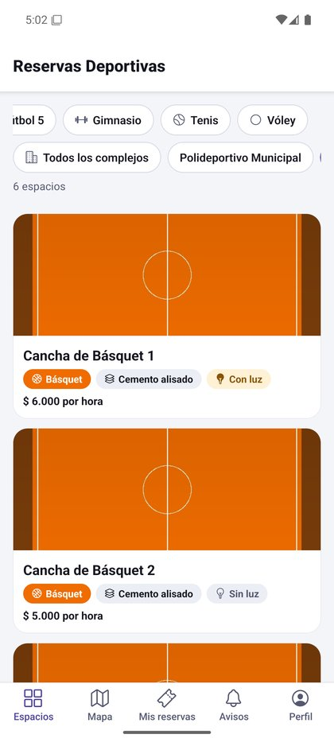 | 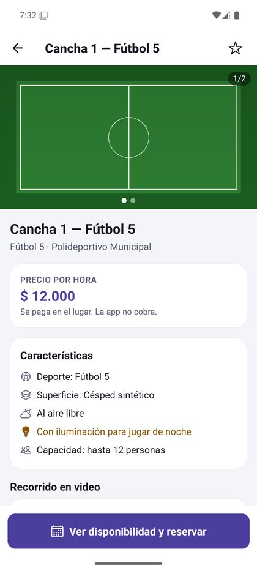 | 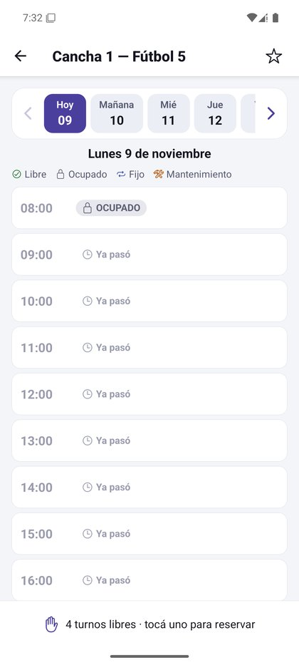 |

---

## 5. Cómo se habla con la API

Archivos: `src/servicios/cliente.ts`, `src/servicios/protocolo.ts`, `src/tipos/index.ts`.

### 5.1 `solicitar()`: el único `fetch` de la app

1. Arma la URL con la dirección guardada en **Perfil › Servidor** (o la de `EXPO_PUBLIC_API_URL`).
2. Agrega `Authorization: Bearer <token>` si hay sesión.
3. Si en Perfil se eligió "Probar errores", agrega la cabecera `X-Simular` (la API simula un error 500
   o una demora de 3 s).
4. Corta la espera a los **30 segundos** (`AbortController`).
5. Interpreta la respuesta con `interpretarRespuesta()` (función pura, con pruebas).

### 5.2 Formato de las respuestas

La API siempre responde igual, y la app lo convierte en un tipo `Resultado<T>`:

```ts
// Éxito                         // Error
{ datos: ..., meta: ... }        { error: { codigo: 'TURNO_OCUPADO', mensaje: 'Ese turno ya fue reservado.' } }

type Resultado<T> =
  | { ok: true;  datos: T; meta: Meta | null; desdeCache: boolean }
  | { ok: false; error: { codigo: string; mensaje: string } };
```

- La pantalla **muestra el `mensaje`** de la API tal cual y **decide por el `codigo`**
  (por ejemplo, con `TURNO_OCUPADO` recarga la grilla).
- Si la API responde `NO_AUTENTICADO`, la app cierra la sesión sola.
- Errores propios de la app: `ERROR_RED` (sin conexión), `SIN_SERVIDOR` (falta la dirección),
  `RESPUESTA_INVALIDA` (la dirección no es la de la API).

### 5.3 `conRespaldo()`: funcionar sin conexión

Para las lecturas importantes (catálogo, mis reservas, una reserva): si la red falla, devuelve lo último
guardado en SQLite marcado como `desdeCache: true`, y la pantalla avisa "estás viendo los datos guardados".

### 5.4 Endpoints que usa la app

| Tema | Endpoints |
|---|---|
| Salud | `GET /salud` (botón "Probar" de Perfil › Servidor) |
| Sesión | `POST /auth/ingreso`, `POST /auth/registro`, `GET /yo`, `PATCH /yo` |
| Catálogo | `GET /deportes`, `GET /espacios`, `GET /espacios/:id`, `PATCH /espacios/:id` (precio) |
| Turnos | `GET /espacios/:id/turnos?fecha=` |
| Reservas | `POST /reservas`, `GET /yo/reservas?cuando=proximas` (y `pasadas`), `GET /reservas/:id`, `POST /reservas/:id/cancelacion` |
| Personal | `GET /agenda`, `GET /reservas?fecha=`, `POST /ingresos`, `POST /reservas/:id/ausente`, `GET /usuarios/:id` |
| Bloqueos | `GET /bloqueos`, `POST /bloqueos`, `DELETE /bloqueos/:id` |
| Fijas | `GET /fijas`, `POST /fijas`, `PATCH /fijas/:id`, `DELETE /fijas/:id` (baja) |
| Archivos | `POST /archivos` (foto de cancha) |

El id de un turno es **determinístico**: `tur-<espacioId>-<AAAAMMDD>-<HH>`, por ejemplo
`tur-esp-02-20260919-19`. Por eso la app puede saber fecha y hora de una reserva solo con su `turnoId`
(`src/logica/grilla.ts › parseIdTurno`).

---

## 6. Recorrido completo de una reserva

Seguí este camino en el código; es la mejor forma de entender cómo encajan las piezas.

1. **Espacios** (`(tabs)/index.tsx`) muestra el catálogo que carga `CatalogoContext` (y guarda en SQLite).
2. Se toca un espacio → **Ficha** (`espacio/[id].tsx`) → "Ver disponibilidad".
3. **Grilla** (`disponibilidad/[id].tsx`) pide `obtenerTurnos(espacioId, fecha)` para el día elegido
   (7 días visibles, de 8 a 24 h). Cada turno es Libre / Ocupado / Fijo / Mantenimiento / Ya pasó.
4. Tocar un turno libre (toque 1) abre la hoja de confirmación. Si no hay sesión → "Ingresar para reservar".
   El personal no puede reservar.
5. **Confirmar** (toque 2) → `reservar(turnoId, cantidadPersonas)` → `POST /reservas`.
6. La API valida (turno libre, máximo 3 activas, capacidad...). Si falla, se muestra su mensaje.
7. Éxito → vibración, se abre **Mi reserva** (`reserva/[id].tsx`) con el **QR** y "¡Reserva confirmada!".
8. La sincronización de la sesión (`SesionContext › sincronizar`) guarda mis reservas en SQLite y
   **programa el recordatorio local** 2 h antes (`notificaciones.ts › sincronizarRecordatorios`).
9. En la puerta, el encargado escanea el QR (`gestion/escanear.tsx`) → `POST /ingresos` → "INGRESO VÁLIDO".

| Reserva confirmada | Agenda del encargado | Escaneo válido |
|---|---|---|
| 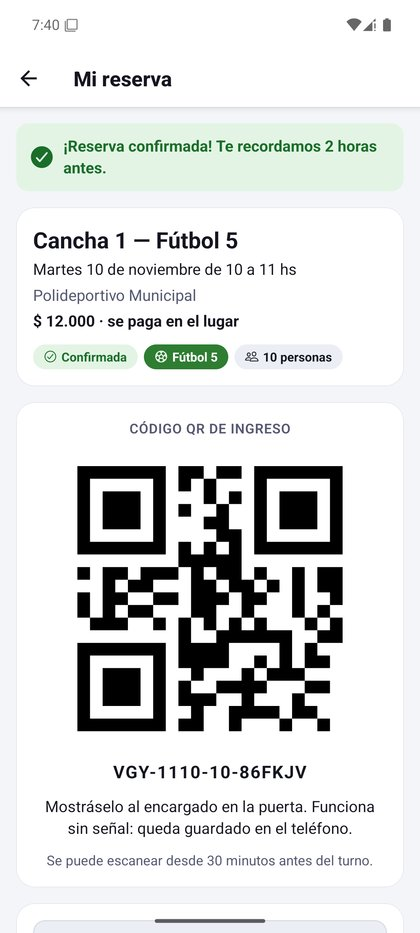 | 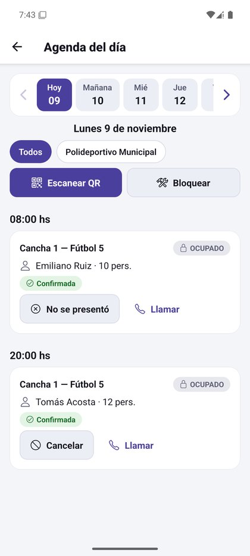 | 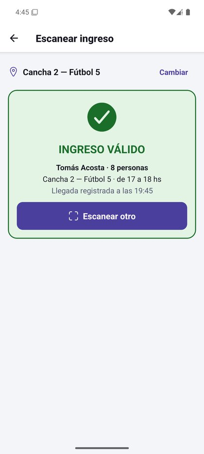 |

---

## 7. Sesión, seguridad y reingreso

Archivos: `src/contexto/SesionContext.tsx`, `src/servicios/usuarios.ts`, `src/almacenamiento/seguro.ts`,
`src/componentes/VerificarIdentidad.tsx`, `src/logica/sha256.ts`.

- **Mirar no requiere cuenta**; la cuenta se pide recién para reservar.
- Al ingresar, la API devuelve un **token**. Se guarda **cifrado en SecureStore**; los datos del usuario
  van en kv-store. La API no tiene "cerrar sesión": la app olvida el token.
- **Reingreso:** al abrir la app con sesión guardada, se **bloquea al instante** y pide **huella o rostro**
  (`expo-local-authentication`). Si el teléfono no tiene biometría, o la persona elige
  "Usar contraseña", se confirma con la contraseña.
- **Reingreso sin red:** al ingresar con red se guarda en SecureStore una **huella SHA-256 con sal,
  iterada 2000 veces** de la contraseña (nunca la contraseña). Sin conexión, la contraseña escrita se
  compara contra esa huella. Así el jugador puede abrir la app y mostrar su QR en una cancha sin señal.
- El **encargado vuelve a identificarse** (huella o contraseña) antes de abrir el escáner.
- Si la API responde `NO_AUTENTICADO` (token vencido o base reiniciada) se cierra la sesión.

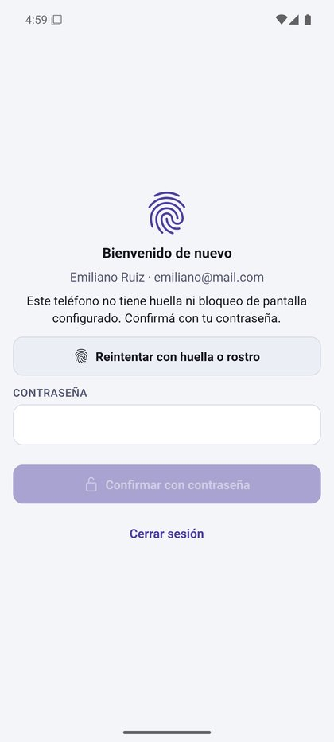

---

## 8. Persistencia: qué se guarda y dónde

| Dónde | Qué | Archivo |
|---|---|---|
| **SecureStore** (cifrado) | Token de sesión, huella de la contraseña | `almacenamiento/seguro.ts` |
| **kv-store** (clave-valor) | Usuario de la sesión, tema, dirección del servidor, simulación de errores, avisos entregados, reservas canceladas por mí | `almacenamiento/kv.ts` |
| **SQLite** (`datos-locales.db`) | Espacios, deportes, mis reservas (con QR), avisos, fotos de canchas, últimas grillas de favoritos | `almacenamiento/db.ts` |
| **Archivos** (`Paths.document`) | Fotos y videos descargados para ver sin datos | `servicios/medios.ts` |

SQLite usa una sola tabla `documentos (coleccion, id, dueno, datos)`: cada objeto se guarda como JSON.
La columna `dueno` separa los datos de cada usuario (por ejemplo, las reservas de cada cuenta).

---

## 9. Notificaciones y avisos

Archivos: `src/notificaciones/notificaciones.ts`, `src/servicios/avisos.ts`, `src/logica/avisos.ts`.

Todas son **notificaciones locales**: las programa el teléfono, sin servidor de push.

- **Recordatorio:** 2 horas antes de cada reserva confirmada. Se reprograman en cada sincronización
  (si se cancela una reserva, su recordatorio desaparece).
- **Avisos** (pestaña Avisos): la API no envía push (su `/dispositivos` responde 501), así que la app
  **detecta los hechos comparando dos fotos de los datos**:
  - **Turno suspendido:** una reserva que estaba confirmada y ahora figura cancelada, sin que la haya
    cancelado yo desde este teléfono → la suspendió la Dirección (lluvia, mantenimiento) o el encargado.
  - **Turno liberado:** un turno de un espacio **favorito** que estaba reservado y ahora está libre.
- La sincronización corre al entrar, **cada 60 s** con la app abierta y al volver a la app; los favoritos
  se revisan cada 2 minutos.

---

## 10. Otras funciones del dispositivo

| Función | Cómo | Dónde |
|---|---|---|
| **Cámara / QR** | `CameraView` lee el QR; también se puede escribir el código. Vibración corta = válido, larga = inválido. | `gestion/escanear.tsx` |
| **Mapa** | MapLibre + teselas de OpenStreetMap, centrado en Villaguay. Un marcador por complejo; "Más cerca" y "Cómo llegar". | `(tabs)/mapa.tsx` |
| **Ubicación** | Solo "mientras se usa". Si se niega, la app sigue funcionando. | `utilidades/useUbicacion.ts` |
| **Sin conexión** | Franja "Sin conexión" en toda la app. | `componentes/EstadoRed.tsx` |
| **Tema** | Claro, oscuro, del sistema o "según la luz" (sensor de luz, con histéresis 15/40 lux para no parpadear). | `contexto/TemaContext.tsx` |
| **Fotos de cancha** | Se eligen, se achican, se guardan en el teléfono y se suben con `POST /archivos`. | `gestion/fotos.tsx`, `servicios/medios.ts` |
| **Video** | `expo-video` con controles y descarga. La API de demo no trae videos. | `espacio/[id].tsx` |

| Mapa | Sin conexión | QR de una reserva cancelada |
|---|---|---|
| 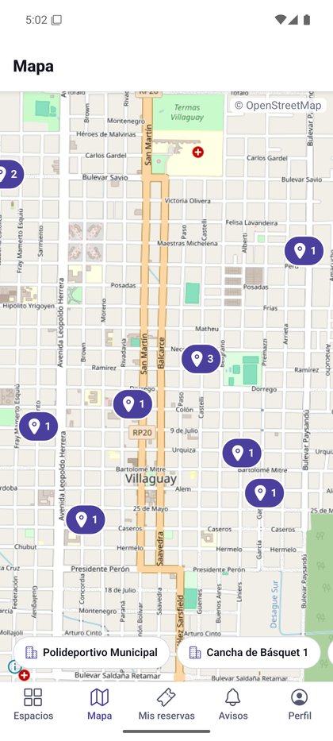 | 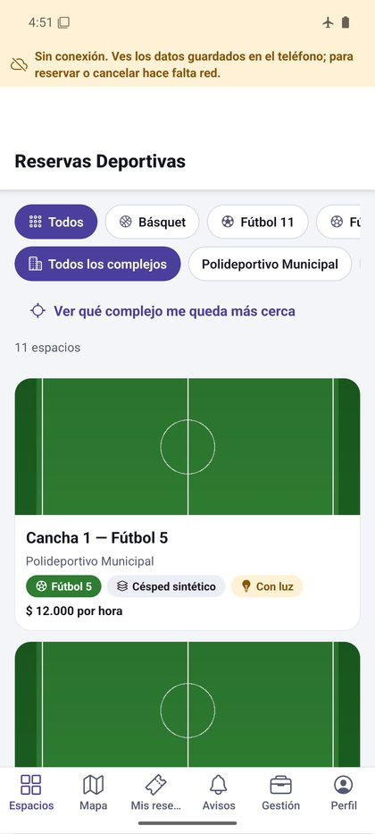 | 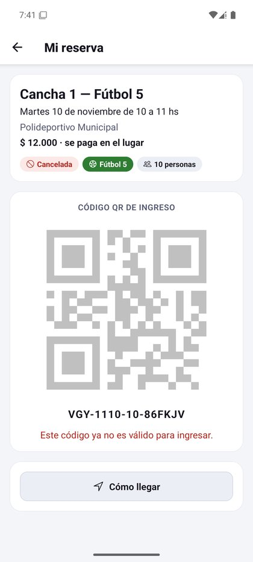 |

---

## 11. Reglas de negocio

Archivo: `src/logica/reglas.ts`. La app las aplica **antes** de llamar a la API para mostrar la pantalla
correcta; la API vuelve a validar todo y, si no coincide, manda el error.

| Regla | Valor |
|---|---|
| Horario de los turnos | De 8 a 24 h, turnos de 1 hora; se ven **7 días** |
| Reservas activas por jugador | Máximo **3** |
| Cancelar sin penalidad | Hasta `cancelableHasta` (**4 h antes**). Después, solo el encargado (suma una cancelación tardía). |
| Recordatorio | **2 h** antes |
| Ventana de ingreso (QR) | Desde **30 min antes** del inicio hasta el fin del turno |
| "No se presentó" | Desde **15 min después** del inicio |
| Jugador "marcado" | A partir de **2** cancelaciones tardías (supuesto de la app, solo informativo) |
| Reserva fija | Solo administrador. La API rechaza superposiciones (`FIJA_SUPERPUESTA`) y conflictos con reservas (`CONFLICTO_CON_RESERVAS`). Baja = `activa: false`. |
| Formato del QR | `VGY-MMDD-HH-XXXXXX`, por ejemplo `VGY-0919-19-K3X9QM` |

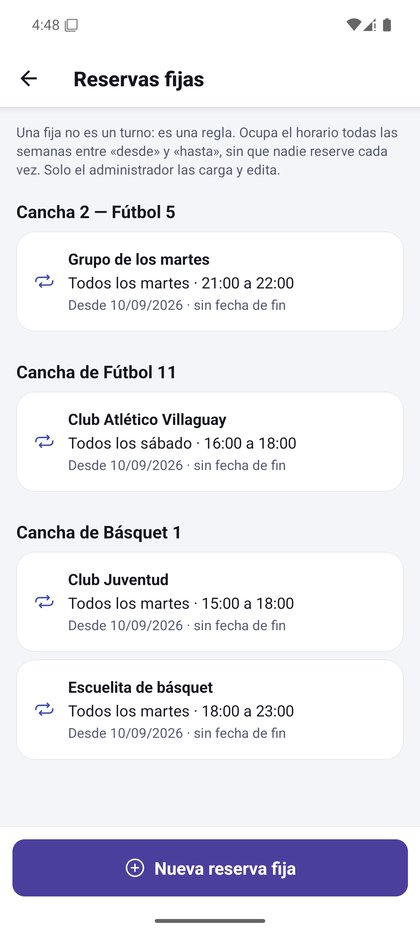

---

## 12. Estados de carga, vacío y error

Archivo: `src/utilidades/useCarga.ts`. Cada pantalla que pide datos usa un **estado discriminado**:

```ts
type EstadoCarga<T> =
  | { tipo: 'cargando' }
  | { tipo: 'exito'; datos: T; desdeCache: boolean }
  | { tipo: 'error'; error: ErrorApi };
```

`useCarga` vuelve a pedir los datos al **enfocar** la pantalla, conserva lo que había mientras actualiza,
descarta respuestas viejas (si cambiaste de día rápido) y ofrece `recargar` para el gesto de deslizar
hacia abajo. Toda pantalla muestra: indicador de carga, mensaje de vacío y error con **Reintentar**.

---

## 13. Pruebas automatizadas

`npm test` corre **38 pruebas** (Jest) sobre la lógica pura, que no necesita teléfono ni red:

| Archivo | Qué prueba |
|---|---|
| `__tests__/api.test.ts` | Formato de las respuestas de la API (`interpretarRespuesta`, `normalizarUrl`, `query`) y detección de avisos (suspensiones y turnos liberados) |
| `__tests__/grilla.test.ts` | Armar y desarmar ids de turno, qué fija cubre un turno |
| `__tests__/reglas.test.ts` | Turnos pasados y ventana de 7 días, cancelación, límite de 3 activas, ingreso y ausencias, validaciones de formularios |
| `__tests__/complejos.test.ts` | Espacios sin complejo ("Otros espacios") y SHA-256 con vectores conocidos |

Además, `node scripts/probar-api.mjs http://localhost:3000` recorre la API real y confirma que responde
lo que la app espera (prueba de humo del contrato).

---

## 14. Decisiones importantes (resumen)

El detalle está en [`docs/DECISIONES.md`](../docs/DECISIONES.md).

- **MapLibre en lugar de react-native-maps:** en Android, react-native-maps usa Google Maps y exige una
  API key con cuenta de facturación. MapLibre + OpenStreetMap es libre y cubre lo mismo.
- **API en modo local:** la API corre en la PC del grupo (permitido por la cátedra). La dirección se
  carga en Perfil › Servidor, así el mismo APK sirve en cualquier PC.
- **Avisos detectados por la app** (la API no envía push).
- **Fotos de cancha** guardadas en el teléfono que las sube (la API no tiene cómo asociarlas al espacio).
- **Espacios sin complejo:** la API usa `complejo: "—"`; la app los muestra como "Otros espacios".
- **Sin selector de deporte ni "mover turno":** la API define el deporte por espacio y no permite mover.

---

## 15. Preguntas para repasar (tipo defensa)

1. **¿Por qué ninguna pantalla llama a `fetch`?** Para tener un solo lugar que conoce la API
   (`src/servicios/`): manejo de token, errores, tiempo de espera y respaldo sin conexión centralizados.
2. **¿Dónde se guarda el token y por qué ahí?** En SecureStore, que lo cifra con el almacén seguro del
   sistema (Keystore en Android). kv-store o SQLite no están cifrados.
3. **¿Cómo funciona el reingreso con huella?** Al abrir con sesión guardada la app se bloquea y llama a
   `LocalAuthentication.authenticateAsync`. Si no hay biometría, pide la contraseña.
4. **¿Y si no hay internet en la cancha?** Las reservas y su QR están en SQLite; la contraseña se valida
   contra una huella SHA-256 con sal guardada en SecureStore. El encargado sí necesita red para validar.
5. **¿Cómo sabe la app que un turno fue suspendido si la API no manda push?** Compara las reservas
   guardadas con las nuevas: confirmada → cancelada, sin haberla cancelado yo = suspensión.
6. **¿Qué pasa si dos personas reservan el mismo turno a la vez?** La API acepta una; la otra recibe
   `TURNO_OCUPADO` y la app recarga la grilla.
7. **¿Por qué no se puede cancelar a último momento?** Regla de la API: hasta 4 h antes. Después hay
   que avisar al encargado, que cancela y le suma una cancelación tardía al jugador.
8. **¿Cómo se valida un QR?** La app manda el código y la cancha a `POST /ingresos`; la API verifica que
   sea de hoy, de esa cancha, en horario y sin usar. La app muestra el resultado con color y vibración.
9. **¿Qué es Expo Router?** Navegación por archivos: la estructura de `src/app/` define las rutas;
   `(tabs)` es un grupo de pestañas y `[id]` una ruta dinámica.
10. **¿Por qué hay estado global con Context?** Sesión, tema y catálogo se usan en muchas pantallas;
    Context evita pasarlos de pantalla en pantalla.
11. **¿Cómo se prueba el manejo de errores sin romper la API?** Perfil › Probar errores manda la
    cabecera `X-Simular` y la API responde un 500 o una demora.
12. **¿Por qué el emulador usa `10.0.2.2`?** Es la dirección con la que el emulador ve a la PC;
    `localhost` dentro del emulador es el propio emulador.

---

## 16. Glosario

| Término | Significado |
|---|---|
| **Turno** | Una hora de un espacio en una fecha (ej. Cancha 2, 19 a 20 h). |
| **Reserva** | Un turno tomado por un jugador. Estados: confirmada, cancelada, cumplida, ausente. |
| **Reserva fija** | Regla semanal (todos los martes 21-22 h) que ocupa el turno sin que nadie reserve. |
| **Bloqueo** | Cancha cerrada un día o un rango horario (lluvia, mantenimiento). Suspende las reservas. |
| **Cancelación tardía** | Cancelación hecha por el encargado después del plazo de 4 h. |
| **PRD** | Documento de requisitos del producto entregado por la cátedra. |
| **APK** | Archivo instalador de Android. |
| **AVD** | Dispositivo virtual de Android (el emulador). |
